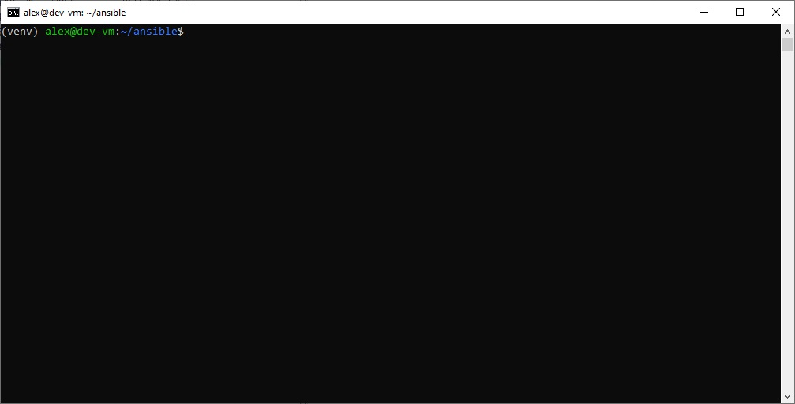
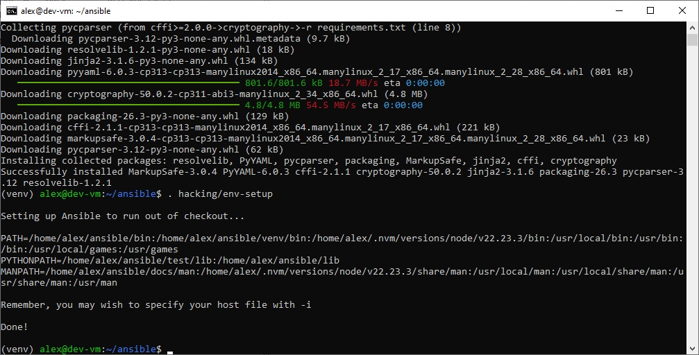

# Домашнее задание к занятию 6 «Создание собственных модулей»

## Подготовка к выполнению

#### 1. Создайте пустой публичный репозиторий в своём любом проекте: my_own_collection.
**Ответ:** Создан публичный репозиторий https://github.com/akamsoft/my_own_collection (пустой, без README).

#### 2. Скачайте репозиторий Ansible: git clone https://github.com/ansible/ansible.git по любому, удобному вам пути.
**Ответ:** Выполнено.
```bash
cd ~
git clone https://github.com/ansible/ansible.git
```

#### 3. Зайдите в директорию Ansible: cd ansible.
**Ответ:** Выполнено.
```bash
cd ~/ansible
```

#### 4. Создайте виртуальное окружение: python3 -m venv venv.
**Ответ:** Выполнено.
```bash
python3 -m venv venv
```
**Ответ:** Выполнено. Приглашение терминала показывает `(venv)`.

#### 5. Активируйте виртуальное окружение: . venv/bin/activate. Дальнейшие действия производятся только в виртуальном окружении.



#### 6. Установите зависимости pip install -r requirements.txt.
**Ответ:** Выполнено.

#### 7. Запустите настройку окружения . hacking/env-setup.



#### 8. Если все шаги прошли успешно — выйдите из виртуального окружения deactivate.
**Ответ:** Выполнено.

#### 9. Ваше окружение настроено. Чтобы запустить его, нужно находиться в директории ansible и выполнить конструкцию . venv/bin/activate && . hacking/env-setup.

## Основная часть

#### Шаг 1. В виртуальном окружении создайте новый `my_own_module.py`
**Ответ:** Создан файл `plugins/modules/my_own_module.py` в репозитории коллекции.

#### Шаг 2. Наполните его содержимым
**Ответ:** Использован шаблон из задания (`my_test`) как основа. Блоки `DOCUMENTATION`, `EXAMPLES`, `RETURN` переписаны под задачу.

#### Шаг 3. Заполните файл так, чтобы модуль создавал файл по `path` с `content`
**Ответ:** Модуль реализован:
- Параметр `path` (str, required=True) — путь к файлу.
- Параметр `content` (str, required=False, default="") — содержимое.
- Идемпотентность: сравнение текущего содержимого с `content`; если совпадает — `changed=false`.
- `check_mode`: возвращает `changed=true`, но файл не пишет.
- Создаёт родительские каталоги (`os.makedirs`).

**Команда проверки синтаксиса:**
```bash
python3 -m py_compile plugins/modules/my_own_module.py && echo "OK"
# → OK
```

**Команда проверки документации:**
```bash
ansible-doc -j -M plugins/modules my_own_module | python3 -m json.tool | head -20
# → JSON с параметрами path и content
```

#### Шаг 4. Проверьте module на исполнимость локально
**Ответ:** Прогон `single_module_playbook.yml` дал `changed=1`, файл создан.

**Команда:**
```bash
cd playbooks
ansible-playbook single_module_playbook.yml
```

**Результат:**
```
TASK [Create file with content]  changed: [localhost]
PLAY RECAP
localhost : ok=1  changed=1  unreachable=0  failed=0  skipped=0
```

**📸 Скриншот:** `images/04-local-run.png`

#### 5. Напишите single task playbook и используйте module
**Ответ:** Создан `playbooks/single_module_playbook.yml`:
```yaml
- name: Test my_own_module standalone (from library/)
  hosts: localhost
  gather_facts: false
  tasks:
    - name: Create file with content
      my_own_module:
        path: /tmp/my_own_module_standalone.txt
        content: |
          Hello from standalone my_own_module!
          Line 2.
```
Модуль подхватывается из `playbooks/library/my_own_module.py` (стандартный каталог поиска).

#### Шаг 6. Проверьте через playbook на идемпотентность
**Ответ:** Повторный прогон дал `changed=0`.

**Команда:**
```bash
ansible-playbook single_module_playbook.yml
```

**Результат:**
```
TASK [Create file with content]  ok: [localhost]
PLAY RECAP
localhost : ok=1  changed=0  unreachable=0  failed=0  skipped=0
```

**📸 Скриншот:** `images/06-idempotent.png`

#### 7. Выйдите из виртуального окружения
**Ответ:** Выполнено.
```bash
deactivate
```
